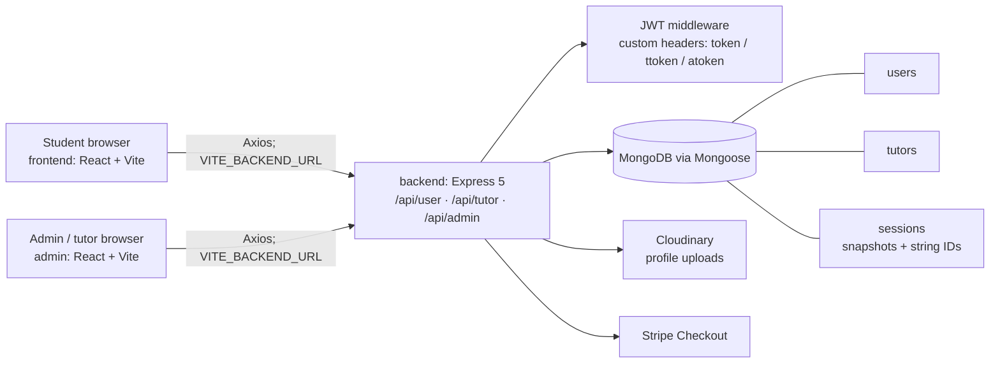
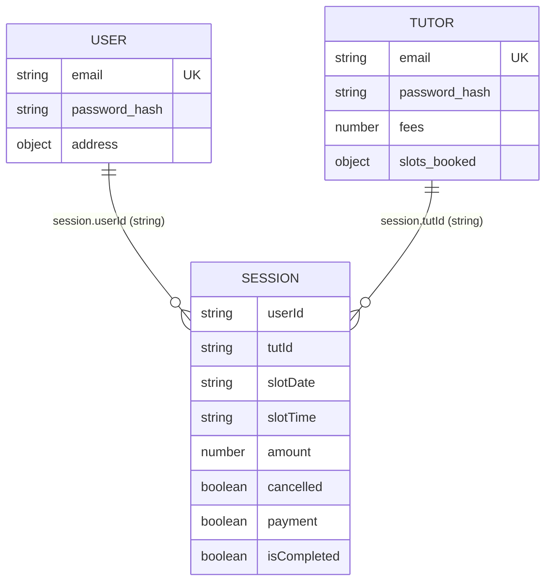

# Repository Audit — Mentee Online Tutoring

**Audit date:** 2026-11-07  
**Scope:** Source and configuration inspection only. No application code, deployment configuration, or secret file contents were changed or read for this report.

## Evidence and limitations

This report distinguishes source-observed behavior from runtime verification. The application was not connected to MongoDB, Cloudinary, Stripe, or Vercel during the audit. A UI screen is therefore not proof that its associated workflow works in production.

The report inspected the three package manifests and lockfiles, routers, controllers, middleware, models, Vite/ESLint/Vercel configuration, frontend contexts, and all Axios call sites. Existing `.env` files were identified by filename and Git tracking status only; their contents were not read or reproduced.

## Verified architecture

| Boundary | Verified implementation | Source evidence |
|---|---|---|
| Public website | React 19 + Vite single-page app; BrowserRouter and `AppContext`; calls the API origin in `VITE_BACKEND_URL`. | `frontend/package.json`, `frontend/src/main.jsx`, `frontend/src/context/AppContext.jsx` |
| Admin/tutor dashboard | Separate React 19 + Vite SPA; distinct admin and tutor context tokens. | `admin/package.json`, `admin/src/main.jsx` |
| API | ESM Node/Express server with user, tutor, and admin router groups. | `backend/server.js`, `backend/routes/*.js` |
| Data | Mongoose `user`, `tutor`, and `session` models. | `backend/models/*.js` |
| Integrations | Cloudinary uploader and Stripe Checkout SDK. | `backend/config/cloudinary.js`, `backend/controllers/userController.js` |

## Dependency and stack inventory

Manifest ranges are recorded below; lockfiles exist at `frontend/package-lock.json`, `admin/package-lock.json`, and `backend/package-lock.json`, but package installation could not be verified locally.

| Area | Technology | Manifest range / configuration |
|---|---|---|
| Public/admin UI | React, React DOM | `^19.1.1` |
| Routing | React Router DOM | frontend `^7.8.1`; admin `^7.8.2` |
| HTTP client | Axios | `^1.11.0` |
| Build | Vite; React plugin | Vite `^7.1.2`; plugin `^5.0.0` |
| Styling | Tailwind, PostCSS, Autoprefixer | `^3.4.17`, `^8.5.6`, `^10.4.21` |
| Linting | ESLint and React plugins | ESLint `^9.33.0` |
| API | Express | `^5.1.0` |
| Persistence | Mongoose / MongoDB | Mongoose `^8.18.0` |
| Authentication | bcrypt, jsonwebtoken, validator | `^6.0.0`, `^9.0.2`, `^13.15.15` |
| Media | Multer, Cloudinary | `^2.0.2`, `^2.7.0` |
| Payments | Stripe Node SDK | `^18.4.0` |
| Runtime config | dotenv, cors | `^17.2.1`, `^2.8.5` |

## Page-to-API map

Routes below are the rendered page routes from `frontend/src/App.jsx` and `admin/src/App.jsx`. “Static” means no direct API call was found in the page; nested components may still consume context data.

| App route / page | Observed API use | Status and notes |
|---|---|---|
| `/` — `Home` | Indirect `GET /api/tutor/list` through public `AppContext`, consumed by `FeaturedTutors`. | Partial: catalogue data is fetched; page content is otherwise static. |
| `/tutors`, `/tutors/:subject` — `Tutors` | Indirect `GET /api/tutor/list`. | Partial: client-side exact-subject filter only; no pagination or server search. |
| `/session/:tutId` — `Session` | Indirect list request; `POST /api/user/book-session`. | Partial: availability and allowed time slots are generated client-side; server does not validate a slot policy. |
| `/my-sessions` — `MySessions` | `GET /api/user/sessions`, `POST /api/user/cancel-session`, `POST /api/user/payment-stripe`, `GET /api/user/verify-stripe`. | Partial and unsafe: redirect query triggers payment marking. |
| `/my-profile` — `MyProfile` | Indirect `GET /api/user/get-profile`; `POST /api/user/update-profile` multipart. | Partial: API parsing/validation and upload controls are insufficient. |
| `/login` — `Login` | `POST /api/user/register`, `POST /api/user/login`. | Partial: authentication responses lack finite JWT lifetime and proper HTTP error handling. |
| `/verify` — `Verify` | None found. | Dead/misleading candidate: it is routed but the current payment return targets `/my-sessions`. |
| `/blog` — `Blog` | None found. | Static-only content. |
| `/contact` — `Contact` | None found. | Static-only; no contact submission API route exists. |
| Dashboard login — `admin/src/pages/Login.jsx` | `POST /api/admin/login`, `POST /api/tutor/login`. | Partial: admin token design exposes password material. |
| `/admin-dashboard` — `Dashboard` | `POST /api/admin/dashboard` via `AdminContext`. | Partial: counts all sessions and does not provide a financial lifecycle. |
| `/all-sessions` — `AllSessions` | `GET /api/admin/sessions`, `POST /api/admin/cancel-session`. | Partial: cancellation policy is incomplete. |
| `/tutors-list` — `TutorsList` | `POST /api/admin/all-tutors`, `POST /api/admin/change-availability`. | Partial: read uses POST; availability toggle is not atomic. |
| `/add-tutor` — `AddTutor` | `POST /api/admin/add-tutor` multipart. | Partial: server checks basic fields but does not robustly constrain data or uploads. |
| `/tutor-dashboard` — `TutorDashboard` | `GET /api/tutor/dashboard`; completion/cancellation calls. | Partial: earnings include completed but unpaid sessions. |
| `/tutor-sessions` — `TutorSessions` | `GET /api/tutor/sessions`; completion/cancellation calls. | Partial: tutor cancellation does not release the slot. |
| `/tutor-profile` — `TutorProfile` | `GET /api/tutor/profile`, `POST /api/tutor/update-profile`. | Partial: arbitrary fee/address/availability values are not server-validated. |

## API inventory

Custom header names are `token` for students, `ttoken` for tutors, and `atoken` for administrators. All authorization is implemented by route middleware. Callers listed are source-observed.

| Method | Path | Auth | Payload / query | Controller | Caller |
|---|---|---|---|---|---|
| POST | `/api/user/register` | Public | JSON: `name`, `email`, `password` | `registerUser` | `frontend/src/pages/Login.jsx` |
| POST | `/api/user/login` | Public | JSON: `email`, `password` | `loginUser` | `frontend/src/pages/Login.jsx` |
| GET | `/api/user/get-profile` | Student | — | `getProfile` | `frontend/src/context/AppContext.jsx` |
| POST | `/api/user/update-profile` | Student | Multipart: `name`, `phone`, `address`, `dob`, `gender`, optional `image` | `updateProfile` | `frontend/src/pages/MyProfile.jsx` |
| POST | `/api/user/book-session` | Student | JSON: `tutId`, `slotDate`, `slotTime` | `bookSession` | `frontend/src/pages/Session.jsx` |
| GET | `/api/user/sessions` | Student | — | `listSessions` | `frontend/src/pages/MySessions.jsx` |
| POST | `/api/user/cancel-session` | Student | JSON: `sessionId` | `cancelSession` | `frontend/src/pages/MySessions.jsx` |
| POST | `/api/user/payment-stripe` | Student | JSON: `sessionId` | `paymentStripe` | `frontend/src/pages/MySessions.jsx` |
| GET | `/api/user/verify-stripe` | Student | Query: `sessionId` | `verifyStripe` | `frontend/src/pages/MySessions.jsx` |
| GET | `/api/tutor/list` | Public | — | `tutorsList` | `frontend/src/context/AppContext.jsx` |
| POST | `/api/tutor/login` | Public | JSON: `email`, `password` | `loginTutor` | `admin/src/pages/Login.jsx` |
| GET | `/api/tutor/sessions` | Tutor | — | `sessionsTutor` | `admin/src/context/TutorContext.jsx` |
| POST | `/api/tutor/complete-session` | Tutor | JSON: `sessionId` | `sessionComplete` | `admin/src/context/TutorContext.jsx` |
| POST | `/api/tutor/cancel-session` | Tutor | JSON: `sessionId` | `sessionCancel` | `admin/src/context/TutorContext.jsx` |
| GET | `/api/tutor/dashboard` | Tutor | — | `tutorDashboard` | `admin/src/context/TutorContext.jsx` |
| GET | `/api/tutor/profile` | Tutor | — | `tutorProfile` | `admin/src/context/TutorContext.jsx` |
| POST | `/api/tutor/update-profile` | Tutor | JSON: `fees`, `address`, `available` | `updateTutorProfile` | `admin/src/pages/tutor/TutorProfile.jsx` |
| POST | `/api/admin/login` | Public | JSON: `email`, `password` | `loginAdmin` | `admin/src/pages/Login.jsx` |
| POST | `/api/admin/add-tutor` | Admin | Multipart tutor data plus optional `image` | `addTutor` | `admin/src/pages/admin/AddTutor.jsx` |
| POST | `/api/admin/all-tutors` | Admin | Empty JSON body | `allTutors` | `admin/src/context/AdminContext.jsx` |
| POST | `/api/admin/change-availability` | Admin | JSON: `tutId` | `changeAvailability` | `admin/src/context/AdminContext.jsx` |
| GET | `/api/admin/sessions` | Admin | — | `sessionsAdmin` | `admin/src/context/AdminContext.jsx` |
| POST | `/api/admin/cancel-session` | Admin | JSON: `sessionId` | `sessionCancel` | `admin/src/context/AdminContext.jsx` |
| POST | `/api/admin/dashboard` | Admin | Empty JSON body | `adminDashboard` | `admin/src/context/AdminContext.jsx` |

## Roles and feature matrix

| Role | Feature | Status | Evidence / limitation |
|---|---|---|---|
| Visitor | Browse tutors | Partial | Public list endpoint exists; filters run only in browser. |
| Visitor | View tutor details | Partial | Detail UI renders list data; address UI references `location` while model/API use `address`. |
| Visitor | Blog / contact | Static-only | No data or contact-submission API found. |
| Student | Register and login | Partial | bcrypt is used, but JWTs do not expire and errors use success JSON rather than appropriate statuses. |
| Student | Profile and image update | Partial | Profile endpoint exists; upload file type/size controls and robust input validation are absent. |
| Student | Book a session | Partial | Server stores a session but does not atomically reserve a slot or validate booking date/time. |
| Student | View/cancel own sessions | Partial | Ownership is checked on student cancellation, but not idempotently and paid-session policy is undefined. |
| Student | Pay by card | Partial | Checkout creation exists, but the redirect path can mark payment true without Stripe verification. |
| Tutor | Login and profile | Partial | Tutor authentication/profile endpoints exist; role claims, expiry, and validation are missing. |
| Tutor | View, complete, cancel assigned sessions | Partial | Tutor ownership is checked, but cancelling leaves `slots_booked` unchanged; completion ignores payment state. |
| Tutor | Dashboard earnings | Partial | Counts completed sessions, including unpaid/cancelled sessions. |
| Admin | Login | Partial | Credentials are compared from environment, then embedded in a signed JWT payload. |
| Admin | Add/list tutors and availability | Partial | Endpoints exist; validation is limited and availability toggling is read-then-write. |
| Admin | View/cancel sessions and dashboard | Partial | Endpoints exist; cancel flow has no payment/refund policy or robust null/idempotency handling. |

## Data model and query relationships

- `userModel` stores a unique email, bcrypt hash, profile attributes, and a default base64 image (`backend/models/userModels.js`).
- `tutorModel` stores a unique email, bcrypt hash, fee, availability, address, and an unindexed object keyed by date in `slots_booked` (`backend/models/tutorModel.js`).
- `sessionModel` stores `userId` and `tutId` as strings rather than Mongoose object references and copies full `userData` and `tutData` snapshots at booking time (`backend/models/sessionModel.js`). This preserves historic display data but risks stale personal data and makes referential integrity application-managed.
- Booking first loads a tutor, edits `slots_booked` in memory, creates a session, then persists the tutor slot object. That crosses collections without a transaction or atomic guard (`bookSession`).
- User and administrator cancellation release a slot; tutor cancellation only marks the session cancelled (`cancelSession` in `userController.js`, `adminController.js`, and `tutorController.js`).

## Environment inventory

Actual environment-file contents were not inspected. The following variable *names* were observed in runtime code or safe templates.

| Scope | Names |
|---|---|
| Backend runtime | `PORT`, `MONGO_URI`, `CLDN_NAME`, `CLDN_API_KEY`, `CLDN_API_SECRET`, `JWT_SECRET`, `ADMIN_EMAIL`, `ADMIN_PASS`, `STRIPE_SECRET_KEY`, `CURRENCY` |
| Backend deployment template (not all currently consumed) | `STRIPE_WEBHOOK_SECRET`, `ALLOWED_ORIGINS`, `FRONTEND_URL`, `ADMIN_URL`, `NODE_ENV` plus the runtime variables above |
| Frontend / admin Vite | `VITE_BACKEND_URL` only |

Observed filenames: `backend/.env`, `frontend/.env`, and `admin/.env`. All three are currently Git-tracked. `frontend/.gitignore` and `admin/.gitignore` exist, but neither ignores `.env`, `.env.*`, `.vite`, or `.vercel`; no root or backend `.gitignore` was found.

## Security findings

### Critical

1. **Potentially exposed environment credentials are tracked in Git.** The three real `.env` filenames are tracked, and the project context states the original archive contained populated environment files. Their values were not accessed during this audit. Treat MongoDB, Cloudinary, Stripe, JWT, and administrator credentials as compromised: rotate them and remove secrets from history before deployment.
2. **Admin password is placed in the JWT payload.** `loginAdmin` signs `email + password`, while `authAdmin` compares the decoded value to the same secret-bearing string (`backend/controllers/adminController.js: loginAdmin`; `backend/middlewares/authAdmin.js`). JWT signatures prevent tampering, not payload disclosure.
3. **Payment can be marked successful without Stripe verification.** `verifyStripe` trusts a browser-provided `sessionId` and directly sets `session.payment = true`; it neither verifies a Stripe event nor verifies that the session belongs to the caller (`backend/controllers/userController.js: verifyStripe`).
4. **Concurrent bookings can double-reserve a tutor/time slot.** `bookSession` performs a read-modify-write update of `slots_booked`, with a separate session insert. Concurrent requests can both observe availability (`backend/controllers/userController.js: bookSession`).

### High

1. **Unrestricted CORS.** `app.use(cors())` accepts requests from arbitrary origins (`backend/server.js`).
2. **Authentication is weakly modeled.** User and tutor tokens have no expiration and use the same signing secret/undifferentiated `{ id }` claim. Middleware validates only an ID claim, not the intended role (`authUser.js`, `authTutor.js`).
3. **Database readiness is not enforced.** `connectDB()` catches connection errors without rethrowing and `server.js` begins listening without awaiting it. Protected requests can run while MongoDB is unavailable.
4. **Cancellation has no reliable payment/refund lifecycle.** Endpoints can cancel paid sessions server-side, but there is no Stripe refund or documented policy; tutor cancellation does not release availability.
5. **Uploads have no explicit allow-list or limits.** Multer uses disk storage and the original filename, without file size, MIME, or content validation (`backend/middlewares/multer.js`).

### Medium

1. **Server-side validation is inconsistent.** Object IDs, date/time values, fee bounds, structured address values, and state transitions are largely accepted without validation. Frontend slot generation is not a security boundary.
2. **Error responses and status codes are inconsistent.** Most failures return `200` with `{ success: false }`; middleware uses a misspelled `sucess` key and often returns raw exception messages (`auth*.js`, controllers).
3. **Cancellation and availability updates are not idempotent or atomic.** Missing-session/null cases can throw; availability toggling and slot release are read-modify-write operations.
4. **Session snapshots contain full user/tutor documents.** This risks retaining data beyond the minimum needed and spreads stale profile data into session records.

### Low

1. **Production diagnostics remain in browser/server code.** Multiple `console.log` calls reveal operational detail in normal flows.
2. **Misleading/dead UI elements.** `/verify` has no observed purpose, Contact has no submission flow, ratings are static, and `Session.jsx` reads `tutorInfo.location` although the model exposes `address`.
3. **Read operations use POST in places.** `/api/admin/all-tutors` and `/api/admin/dashboard` are read-only but POST, complicating caching and HTTP semantics.

## Build and Vercel findings

| Finding | Impact | Evidence |
|---|---|---|
| Frontend/admin dependencies are unavailable locally. | Lint and production build could not run. | `npm.cmd run lint` and `npm.cmd run build` fail because `eslint`/`vite` are not found. |
| Backend has no test suite. | No automated API, authorization, payment, or booking coverage. | `backend/package.json` has placeholder `npm test`, which exits 1. |
| Generated dependencies/cache are tracked. | Repository bloat and non-reproducible installs; may contain platform-specific files. | `backend/node_modules/**` and `admin/.vite/**` are Git-tracked. |
| SPA rewrites are incorrect in live app configs. | Nested-route refreshes may not serve `index.html`. | `frontend/vercel.json` and `admin/vercel.json` rewrite to `/`; corrected examples rewrite to `/index.html` under `deployment/vercel-config/`. |
| Backend uses a legacy Vercel routing config. | Must be tested or replaced with current Express deployment convention; do not mix both models. | `backend/vercel.json` defines `builds` and `routes`. |
| Backend entrypoint is not deployment-hardened. | Framework detection/serverless behavior and DB readiness need validation. | `backend/server.js` always calls `app.listen` and does not export the app. |
| Node runtime is not pinned. | Builds may vary across local/CI/Vercel environments. | No `engines` field in package manifests or version file observed. |

## Prioritized remediation backlog

Effort assumes one engineer familiar with the codebase. Risk describes compatibility/regression risk, not security severity.

| Priority | Work item | Effort | Change risk | Acceptance criteria |
|---|---|---:|---|---|
| P0 | Rotate exposed credentials; remove tracked `.env`, `node_modules`, and `.vite`; add root/backend ignores and safe examples. | S | Medium | No real secret/artifact is tracked; history remediation and rotations are documented. |
| P0 | Replace browser payment verification with signed Stripe webhook processing and idempotent event persistence. | L | High | Only verified Stripe events set paid state; replay, invalid signature, and out-of-order tests pass. |
| P0 | Make reservation atomic and introduce explicit booking/payment/cancellation state rules. | L | High | Concurrent identical booking attempts yield one reservation; cancellation releases once; paid cancellation policy is enforced. |
| P0 | Repair admin authentication; issue finite, role-scoped JWTs with no credentials in claims. | M | Medium | Password never appears in response/token; expired/wrong-role tokens return 401/403. |
| P1 | Add central validation, safe error middleware, resource authorization, upload restrictions, and explicit CORS origins. | L | Medium | Invalid payloads return 4xx; untrusted origin/upload rejected; ownership tests pass. |
| P1 | Make database connection cached/readiness-aware and adopt Vercel-compatible Express entrypoint/configuration. | M | Medium | API fails safely when DB is down and is verified on Vercel Preview. |
| P1 | Establish backend test harness; add unit/integration tests for auth, bookings, cancellations, payments, and dashboard earnings. | L | Medium | `npm test` runs meaningful tests; changed critical paths are covered. |
| P2 | Apply Vite SPA configs, pin Node version, run clean installs/lint/build, and validate three-project Vercel deployment. | M | Low | Both apps build; direct nested-route refresh works; API smoke tests pass. |
| P2 | Correct UI/API contract defects and remove dead/misleading screens/logs. | M | Low | `address` displays consistently, Contact/Verify are implemented or removed, and dashboard figures reflect policy. |

## Verification record

- Attempted `npm run lint` / `npm run build` initially; PowerShell execution policy blocked `npm.ps1`.
- Retried with `npm.cmd` to avoid that shell-policy issue.
- `frontend`: lint and build failed because local `eslint` and `vite` executables are unavailable.
- `admin`: lint and build failed for the same reason.
- `backend`: `npm test` failed as designed because the test script is a placeholder.

No runtime, payment-provider, database, or Vercel deployment claims are made by this audit.
